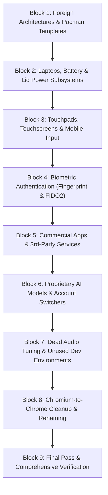

# Bloat Removal Plan: 9 Discrete Execution Blocks

This document defines the 9 discrete execution blocks to eliminate non-workstation bloat from `bin/`, configuration trees, and test suites for the ASUS ProArt X870E and RTX 5060 Ti workstation. Each block is self-contained, keeps the codebase coherent, prunes dead code and dead tests simultaneously, and maintains green test suite passes at every step.

Documentation overhead across these blocks is minimal because `manual/`, `.github/`, `.greptile/`, and upstream plans have already been purged. Only internal architecture references in `AGENTS.md` and `docs/file-layout.md` are updated where applicable.

---

## Execution Sequence

---

### Block 1: Foreign Architectures & Pacman Templates

- **Objective**: Remove ARM, Apple Silicon, Qualcomm Snapdragon, and NVIDIA N1x/GB10 detectors, helpers, and repository templates.
- **Files to Remove**:
  - `bin/omarchy-hw-aarch64`
  - `bin/omarchy-hw-aarch64-apple`
  - `bin/omarchy-hw-aarch64-qualcomm`
  - `bin/omarchy-hw-aarch64-n1x`
  - `bin/omarchy-hw-aarch64-gb10`
  - `bin/omarchy-hw-apple-silicon`
  - `bin/omarchy-hw-n1x`
  - `bin/omarchy-hw-mac`
  - `bin/omarchy-hw-x86` (streamline to unconditional 0 / x86 native)
  - `bin/omarchy-hw-match-device-tree`
  - `bin/omarchy-brightness-display-apple`
  - `bin/omarchy-hyprland-monitor-focused-apple`
  - `default/pacman/aarch64/`
  - `default/pacman/aarch64-apple/`
- **Code Paths & Helpers to Update**:
  - `bin/omarchy-hw-platform`: streamline to return `x86` directly.
  - `bin/omarchy-hw-x86`: streamline to return 0.
  - `install/helpers/pacman.sh`: remove ARM template resolution, point directly to `default/pacman`.
  - `AGENTS.md`: align platform section with x86 workstation focus.
- **Tests to Prune / Align**:
  - `test/shell.d/pacman-templates-test.sh` (drop ARM template tests)
  - `test/shell.d/channel-sudo-boundary-test.sh` (drop ARM template fixtures)
  - `test/shell.d/hw-platform-test.sh` & `test/shell.d/hw-match-device-tree-test.sh`
  - `test/shell.d/mkinitcpio-apple-drop-ins-test.sh`
  - `test/shell.d/brightness-display-apple-cache-test.sh`
- **Verification**: `./test/cli`.

---

### Block 2: Laptops, Battery & Lid Power Subsystems (COMPLETED)

- **Objective**: Purge mobile laptop battery telemetry, low-power alerts, and lid-switch event handlers.
- **Files Removed**:
  - `bin/omarchy-hw-laptop`
  - `bin/omarchy-hw-laptop-closed`
  - `bin/omarchy-hw-clamshell`
  - `bin/omarchy-battery-low`
  - `bin/omarchy-battery-present`
  - `bin/omarchy-battery-status`
  - `bin/omarchy-power-present`
  - `bin/omarchy-notification-battery`
  - `bin/omarchy-system-lid-close`
  - `bin/omarchy-system-lid-inhibit`
  - `bin/omarchy-hyprland-monitor-clamshell`
  - `bin/omarchy-hyprland-monitor-laptop`
  - `bin/omarchy-hyprland-monitor-internal`
  - `bin/omarchy-hyprland-monitor-internal-mirror`
- **Code Paths & Helpers Updated**:
  - `bin/omarchy-system-wake`: dropped clamshell monitor calls.
  - `bin/omarchy-system-sleep-lock`: dropped clamshell monitor calls.
  - `bin/omarchy-hyprland-monitor-watch`: dropped clamshell sync/polling; retained modeless monitor recovery.
  - `default/hypr/bindings/utilities.lua`: removed laptop display, lid switch, and battery hotkeys.
  - `default/omarchy/omarchy-menu.jsonc` & `default/i18n/en/menu.json`: removed battery percentage, laptop display, and mirror display entries.
  - `default/i18n/en/keybindings.json`: removed laptop/battery keybinding descriptions.
  - `shell/plugins/polkit/PolkitAgent.qml`: removed laptopClosed detection and clamshell check.
  - `shell/plugins/panels/power/Panel.qml`: removed `batteryProc`.
  - `shell/plugins/services/battery/Service.qml`: removed battery threshold polling and low-battery warning dispatch.
  - `docs/notifications.md`: removed battery notification references.
- **Tests Pruned & Aligned**:
  - Pruned: `test/shell.d/battery-present-test.sh`, `battery-status-test.sh`, `battery-test.sh`, `power-present-test.sh`, `power-no-battery-test.sh`, `hw-laptop-test.sh`, `lid-close-test.sh`, `lid-inhibit-test.sh`, `monitor-clamshell-scale-test.sh`, `monitor-recovery-test.sh`, `test/shell.d/fixtures/power-no-battery/`.
  - Aligned: `test/shell.d/menu-test.sh`, `monitor-modeless-test.sh`, `monitor-output-name-test.sh`, `sleep-lock-test.sh`, `panel-open-budgets-test.sh`.
- **Verification**: `./test/cli` (120/120 pass), `bin/omarchy commands --check` (440 commands clean).

---

### Block 3: Touchpads, Touchscreens & Mobile Input (COMPLETED)

- **Objective**: Remove trackpad and touchscreen toggle scripts, gestures, and hotkeys.
- **Files Removed**:
  - `bin/omarchy-hw-touchpad`
  - `bin/omarchy-hw-touchscreen`
  - `bin/omarchy-toggle-touchpad`
  - `bin/omarchy-toggle-touchscreen`
  - `bin/omarchy-toggle-input-device`
  - `bin/omarchy-hw-recover-internal-monitor`
  - `default/systemd/user/omarchy-recover-internal-monitor.service`
  - `default/hypr/disabled-input-device.lua`
- **Code Paths & Helpers Updated**:
  - `default/omarchy/omarchy-menu.jsonc` & `default/i18n/en/menu.json`: pruned toggle touchpad/touchscreen rows.
  - `default/hypr/bindings/media.lua`: removed touchpad toggle hotkeys.
  - `default/i18n/en/keybindings.json`: removed touchpad toggle/enable/disable strings.
  - `default/i18n/en/cli.json`: removed touchpad and touchscreen notification strings.
  - `default/hypr/toggles.lua`: dropped disabled-input-device loader.
  - `default/hypr/input.lua`: removed touchpad settings and scroll_touchpad window rules.
  - `install/user/first-run/enable-user-units.sh`: removed recover-internal-monitor service invocation.
  - `shell/plugins/osd/OsdModel.js`: removed touchpad/touchscreen OSD icon entries.
- **Tests Pruned & Aligned**:
  - Pruned: `test/shell.d/hw-touchpad-test.sh`, `test/shell.d/toggle-input-device-test.sh`.
  - Aligned: `test/shell.d/config-test.sh`, `test/cli`.
- **Verification**: `./test/cli` (120/120 pass), `bin/omarchy commands --check` (435 commands clean).

---

### Block 4: Biometric Authentication (Fingerprint & FIDO2) [COMPLETED]

- **Status**: Completed in working tree; ready for commit.
- **Objective**: Purge `fprintd` hardware helpers, fingerprint PAM enrollment tools, FIDO2 setup scripts, and fingerprint integration from lock screen and polkit agent.
- **Files Removed (23 files)**:
  - `bin/omarchy-hw-fingerprint`
  - `bin/omarchy-setup-security-fingerprint`
  - `bin/omarchy-remove-security-fingerprint`
  - `bin/omarchy-setup-security-fido2`
  - `bin/omarchy-remove-security-fido2`
  - `install/user/first-run/setup-fingerprint.hook`
  - `default/systemd/system-sleep/fprintd-resume`
  - `default/systemd/system/fprintd.service.d/10-stop-timeout.conf`
  - `shell/plugins/lock/FingerprintModel.js`
  - `test/shell.d/hw-fingerprint-test.sh`
  - `test/shell.d/fingerprint-invitation-test.sh`
  - `test/shell.d/fingerprint-package-test.sh`
  - `test/shell.d/fprintd-resume-hook-test.sh`
  - `test/shell.d/lock-blank-fingerprint-test.sh`
  - `test/shell.d/lock-fingerprint-indicator-test.sh`
  - `test/shell.d/lock-fingerprint-retry-test.sh`
  - `test/shell.d/lock-fingerprint-service-test.sh`
  - `test/shell.d/fixtures/lock-fingerprint-indicator/shell.qml`
  - `test/shell.d/fixtures/lock-fingerprint-service/shell.qml`
  - `test/shell.d/security-fido2-remove-test.sh`
  - `test/shell.d/security-fido2-test.sh`
  - `test/shell.d/security-fingerprint-remove-test.sh`
  - `test/shell.d/security-polkit-faillock-test.sh`
- **Code Paths & Helpers Updated**:
  - `bin/omarchy-apply-lock`: writes password PAM only and cleans up legacy fingerprint files.
  - `bin/omarchy-provision-first-run`: dropped fingerprint hook invocation.
  - `default/omarchy/omarchy-menu.jsonc` & `default/i18n/en/menu.json`: pruned security setup/remove entries for fingerprint & fido2.
  - `default/i18n/en/shell.json`: dropped `"lock.fingerprintUnavailable"`.
  - `shell/plugins/lock/manifest.json`: updated description to reflect password-only lock screen.
  - `shell/plugins/lock/LockView.qml`: pruned fingerprint reserve and indicators.
  - `shell/plugins/lock/Service.qml`: removed all fingerprint timers, PAM contexts, and recovery loops; reports false in status IPC.
  - `shell/plugins/polkit/PolkitAgent.qml`: removed fingerprint mode, icon glyph, and PAM watcher.
  - `shell/plugins/polkit/PolkitModel.js`: removed fingerprint classifier and PAM parser.
  - `shell/plugins/README.md`: updated lock screen description.
- **Tests Aligned**:
  - `test/shell.d/apply-lock-test.sh`: re-focused on trusted path isolation and password PAM creation with legacy cleanup.
  - `test/shell.d/polkit-test.sh`: tests authorizationLabel without fingerprint prompts.
- **Verification**:
  - `bin/omarchy commands --check`: passed (429 commands).
  - `./test/cli`: 120/120 passed.
  - `find . -xtype l`: 0 broken symlinks.

---

### Block 5: Commercial Apps, Proprietary Services & Non-Stock Editors [COMPLETED]

- **Status**: Completed in working tree; ready for commit.
- **Objective**: Purge commercial cloud sync tools, media players, chat clients, streaming hosts, mesh VPN, proprietary password manager, and non-stock editors (Dropbox, Spotify, Signal, NordVPN, Sunshine, Slack, Tailscale, Bitwarden, Cursor, Helix).
- **Files Removed (36 files)**:
  - Dropbox:
    - `bin/omarchy-install-service-dropbox`, `bin/omarchy-remove-service-dropbox`, `bin/omarchy-installed-service-dropbox`
    - `shell/plugins/panels/dropbox/` (6 files: `DropboxIcon.qml`, `manifest.json`, `Model.js`, `Panel.qml`, `Service.qml`, `status.py`)
    - `test/shell.d/dropbox-test.sh`
  - Spotify: `bin/omarchy-install-service-spotify`, `bin/omarchy-launch-spotify`
  - Signal: `bin/omarchy-install-service-signal`, `bin/omarchy-launch-signal`
  - NordVPN: `bin/omarchy-install-service-nordvpn`
  - Sunshine: `bin/omarchy-install-service-sunshine`, `bin/omarchy-remove-service-sunshine`
  - Tailscale:
    - `bin/omarchy-install-service-tailscale`, `bin/omarchy-remove-service-tailscale`, `bin/omarchy-installed-service-tailscale`
    - `bin/omarchy-tailscale-receive`, `bin/omarchy-tailscale-send`
    - `default/systemd/user/omarchy-tailscale-receive.service`
    - `shell/plugins/panels/tailscale/` (6 files: `manifest.json`, `Model.js`, `Panel.qml`, `README.md`, `Service.qml`, `TailscaleIcon.qml`)
    - `test/shell.d/tailscale-test.sh`, `test/shell.d/tailscale-receive-test.sh`
  - Helix:
    - `bin/omarchy-install-editor-helix`, `bin/omarchy-restart-helix`
    - `default/themed/helix.toml.tpl`
  - Test suites: `test/shell.d/installed-service-test.sh`
- **Code Paths & Helpers Updated**:
  - `bin/omarchy`: removed `tailscale` from `GROUP_DESCRIPTIONS`.
  - `bin/omarchy-bar`: removed optional widgets discovery loop (`optional_widgets="[]"`).
  - `bin/omarchy-default-editor`: pruned `cursor` and `helix` options, usage strings, and install invocations.
  - `bin/omarchy-launch-editor`: removed `hx | helix` case handler.
  - `bin/omarchy-theme-set`: removed `omarchy-restart-helix` from `visible_theme_commands`.
  - `bin/omarchy-theme-set-vscode`: pruned `skip-cursor-theme-changes` block and updated summary.
  - `default/hypr/bindings/applications.lua`: removed Spotify and Signal keybindings.
  - `default/omarchy/launcher.hides`: removed dropbox entry.
  - `default/omarchy/omarchy-menu.jsonc` & `default/i18n/en/menu.json`:
    - Removed `install.service.dropbox`, `install.service.spotify`, `install.service.signal`, `install.service.nordvpn`, `remove.service.dropbox`.
    - Removed `install.service.slack`, `install.service.tailscale`, `install.service.bitwarden`, `remove.service.tailscale`.
    - Removed `install.editor.cursor`, `install.editor.helix`.
    - Removed `setup.default.editor.cursor`, `setup.default.editor.helix`.
  - `default/i18n/en/shell.json`: purged all `dropbox.*` and `tailscale.*` keys.
  - `default/i18n/en/cli.json`: purged `nordvpn.rebootNow` and `tailscale.*` keys.
  - `default/agents/skills/omarchy/capture.md`: removed tailscale send/receive commands.
  - `shell/plugins/README.md` & `shell/plugins/bar/README.md`: removed Tailscale panel/bar widget entries.
  - `shell/plugins/bar/widgets/TrayModel.js`: cleared `widgetsForTrayItems`.
  - `shell/Ui/ToggleSwitch.qml`: updated docstring to remove Tailscale service reference.
- **Tests Aligned**:
  - `test/shell.d/config-test.sh`: removed `omarchy-tailscale-receive.service` from package defaults, replaced tailscale in test layout, simplified bar defaults/refresh tests.
  - `test/shell.d/bar-icon-geometry-test.sh`: removed `DropboxIcon` and `TailscaleIcon` imports, checks, and instantiations.
  - `test/shell.d/plugin-enable-test.sh`, `test/shell.d/plugins-test.sh`, `test/shell.d/bar-test.sh`: re-targeted to `omarchy.elsewhen`.
  - `test/shell.d/menu-test.sh`: updated `editor` array to remove Cursor and Helix; updated ranking assertion.
  - `test/shell.d/default-apps-test.sh`: removed `cursor` and `helix` cases and installers.
  - `test/shell.d/theme-staging-test.sh`: removed `helix.toml` from `colour_only`.
  - `test/shell.d/vscode-theme-test.sh`: removed packaged Cursor executable probes; updated toggle test to `skip-codium-theme-changes`.
  - `test/shell.d/theme-set-budget-test.sh`: removed `skip-cursor-theme-changes` toggle and legacy `qmk_hid` stub assertion.
  - `test/shell.d/tray-test.sh`: removed Dropbox layout assertions.
- **Verification**:
  - `bin/omarchy commands --check`: passed (414 commands clean).
  - `./test/cli`: 120/120 passed.
  - `find . -xtype l`: 0 broken symlinks.

---

### Block 6: Proprietary AI Models, Account Switchers & Redundant Runtimes

- **Objective**: Keep strictly `antigravity-cli` (system default), `opencode` (universal harness), and `llama-server`. Purge multi-account quota rotation scripts and redundant agent wrappers.
- **Files to Remove**:
  - Multi-account rotation: `bin/omarchy-agent-account-*` (10 scripts: `add`, `copy`, `exec`, `home`, `list`, `mode`, `remove`, `rename`, `state`, `transfer`, `use`)
  - Quota scanners: `bin/omarchy-agent-usage-fireworks`, `bin/omarchy-agent-usage-kimi`, `bin/omarchy-agent-usage-update`
  - Unused AI installers & removers:
    - `bin/omarchy-install-ai-chatgpt`, `bin/omarchy-remove-ai-chatgpt`
    - `bin/omarchy-install-ai-claude`, `bin/omarchy-remove-ai-claude`
    - `bin/omarchy-remove-ai-grok-bot`
    - `bin/omarchy-install-ai-hermes`, `bin/omarchy-remove-ai-hermes`, `bin/omarchy-install-hermes-cli`
    - `bin/omarchy-install-ai-openclaw`, `bin/omarchy-remove-ai-openclaw`, `bin/omarchy-install-openclaw-cli`
- **Code Paths & Helpers to Update**:
  - `default/omarchy/omarchy-menu.jsonc`: prune account-switch options.
- **Tests to Prune / Align**:
  - `test/shell.d/agent-account-*.sh` (5 tests)
  - `test/shell.d/agent-usage-*.sh` (4 tests)
  - `test/shell.d/remove-ai-test.sh`
  - `test/shell.d/openclaw-*.sh` (2 tests)
  - `test/shell.d/hermes-*.sh` (4 tests)
- **Verification**: `./test/cli`.

---

### Block 7: Dead Audio Tuning & Unused Dev Environments

- **Objective**: Remove obsolete laptop speaker filter chains and prune unused esoteric language environments.
- **Files to Remove**:
  - `bin/omarchy-audio-tuning`
  - `default/audio/filter-chain-host.conf`
  - `docs/audio-tuning.md`
- **Code Paths & Helpers to Update**:
  - `bin/omarchy-install-dev-env`: prune esoteric/unused language setups (PHP, Laravel, Symfony, OCaml, Elixir, Phoenix, Clojure, Scala, .NET), keeping modern workstation core (Rust, Go, Python/uv, Node/Bun/Deno, Java/Zig).
- **Tests to Prune / Align**:
  - Prune dead audio tuning tests and align dev environment CLI assertions.
- **Verification**: `./test/cli`.

---

### Block 8: Chromium-to-Chrome Cleanup & File Renaming

- **Objective**: Complete the transition from Chromium to Google Chrome across filesystem assets, native messaging hosts, and scripts.
- **Renames & Refactoring**:
  - Rename `default/chromium/` -> `default/chrome/`
  - Rename `bin/omarchy-install-chromium-copy-url` -> `bin/omarchy-install-chrome-copy-url`
  - Rename `bin/omarchy-install-chromium-ytdlp` -> `bin/omarchy-install-chrome-ytdlp`
  - Rename `bin/omarchy-chromium-copy-url-host` -> `bin/omarchy-chrome-copy-url-host`
  - Rename `bin/omarchy-chromium-ytdlp-host` -> `bin/omarchy-chrome-ytdlp-host`
  - Delete `bin/omarchy-install-chromium-claude`
  - Update `config/chrome-flags.conf` to load extensions from `/usr/share/omarchy/default/chrome/extensions/...`
  - Update `bin/omarchy-install-browser` and `bin/omarchy-refresh-chrome`
  - Update native messaging host JSON definitions.
- **Tests to Prune / Align**:
  - Update `test/shell.d/chromium-*.sh` tests -> `chrome-*.sh`
  - Update browser launch tests in `test/shell.d/launch-browser-test.sh`.
- **Verification**: `./test/cli`.

---

### Block 9: Final Pass & Comprehensive Verification

- **Objective**: Perform an end-to-end audit to ensure the repository is completely green and dead-code free.
- **Actions**:
  - Run `omarchy commands --check` to ensure every remaining CLI command has valid metadata and routing.
  - Run `./test/cli` (120 test suites).
  - Verify 0 broken symlinks (`find . -xtype l`).
  - Verify clean `git status`.
