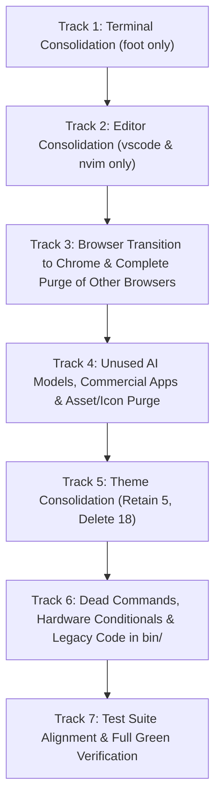

# Deep Workstation Cleanup & Zero-Dead-Code Plan

**Target Workstation**: ASUS ProArt X870E + AMD Ryzen 9 9900X + Headless NVIDIA RTX 5060 Ti AI Accelerator
**Core Toolset**:

- **Exclusive Terminal**: `foot`
- **Exclusive Editors**: `vscode` (`code`) & `neovim` (`nvim`)
- **Exclusive Browser**: `google-chrome`
- **Retained AI Stack**: `antigravity-cli` (`agy`), `opencode`, `kimi`, `pi`, `llama-server`
- **Retained Themes (5)**: `everforest`, `last-horizon`, `matte-black`, `miasma`, `osaka-jade` (Default: `matte-black`)
- **Installation Profile**: Fresh Installation (Zero pre-existing state, zero legacy migration overhead)

---

## 1. Architectural Principles & Grounding Facts

1. **Fresh Installation Target**: The system is provisioned exclusively onto a fresh installation. There is zero need to support pre-existing user configurations, legacy config migrations from Omarchy 3.8.x, or fallback upgrade paths.
2. **Zero Dead Code**: Unreachable code blocks, functions calling non-existent scripts, dead branches in `if`/`case`/`for` loops, and checks for eliminated platforms, architectures, hardware components, browsers, terminals, editors, themes, or applications must be physically eliminated rather than stubbed or hidden.
3. **Physical Asset Cleanup**: All unused icons (`.png`, `.svg`), theme directories, theme templates, and window rules for purged applications must be removed from the repository.
4. **Divided Context Tracks**: Work is divided into 7 discrete, cohesive tracks to allow atomic execution, comprehensive review in VS Code's Source Control pane, and 100% verification at each boundary.

---

## 2. Track Breakdown

---

### Track 1: Terminal Consolidation (Sole Terminal: `foot`) [COMPLETED & VERIFIED]

- **Status**: Completed & 100% Verified
- **Objective**: Establish `foot` as the exclusive terminal emulator across the entire operating system. Obliterate all configuration directories, templates, control loops, process signals, and menu entries for `alacritty`, `ghostty`, and `kitty`.
- **Files Deleted**:
  - `config/alacritty/` (entire directory)
  - `config/ghostty/` (entire directory)
  - `config/kitty/` (entire directory)
  - `default/alacritty/` (entire directory)
  - `default/ghostty/` (entire directory)
  - `default/themed/alacritty.toml.tpl`
  - `default/themed/ghostty.conf.tpl`
  - `default/themed/kitty.conf.tpl`
  - `config/omarchy/themed/alacritty.toml.tpl.sample` (replaced with `foot.ini.tpl.sample`)
  - `test/shell.d/kitty-config-test.sh`
  - `test/shell.d/fixtures/kitty/` (entire directory)
- **Script Simplifications & Loop Flattening**:
  - `bin/omarchy-default-terminal`: Locked to `foot`, removed other terminal branches.
  - `bin/omarchy-install-terminal`: Restricted to `foot`.
  - `bin/omarchy-cmd-terminal-cwd`: Removed `kitty_socket` branch and `kitten @`, using proc children.
  - `bin/omarchy-font-set`: Removed Alacritty, Kitty, Ghostty sed patching and signals, kept Foot.
  - `bin/omarchy-display-text-size`: Removed Alacritty, Kitty, Ghostty sizing and queries, kept Foot.
  - `bin/omarchy-launch-screensaver`: Stripped case loop down to `foot` only.
  - `bin/omarchy-refresh-applications`: Removed Alacritty `.desktop` copy block.
  - `bin/omarchy-theme-set`: Set `INSTALLED_THEME_DENIED=(foot.ini vscode.json)`, removed `stage_installed_colors_from_alacritty`.
  - `bin/omarchy-theme-set-glass`: Removed Alacritty, Kitty, Ghostty glass rules, kept Foot.
  - `default/bash/aliases`: Simplified `ff` alias directly to `bat` preview.
  - `default/hypr/apps/terminals.lua`: Streamlined regex to `(foot|org\\.codeberg\\.dnkl\\.foot|org\\.omarchy\\..*|TUI\\..*)`.
  - `default/i18n/en/cli.json`: Updated `"screensaver.terminalOnly"` to `"Screensaver only runs in Foot"`.
  - `default/omarchy/omarchy-menu.jsonc` & `default/i18n/en/menu.json`: Pruned alacritty, ghostty, and kitty entries.
  - `default/agents/skills/omarchy/`: Aligned `SKILL.md`, `hyprland.md`, `theming.md` to Foot.
- **Verification**:
  - `bin/omarchy commands --check` passed (383 commands).
  - `./test/cli` passed (108/108 tests green).
  - Shell tests `theme-templates-test.sh`, `theme-staging-test.sh`, `hyprland-window-transparency-test.sh`, `default-apps-test.sh`, `hyprland-focus-app-test.sh`, `command-operand-boundaries-test.sh` passed 100% green.
  - Zero broken symlinks (`find . -xtype l`).

---

### Track 2: Editor Consolidation (Sole Editors: `vscode` & `nvim`) [COMPLETED & VERIFIED]

- **Status**: Completed & 100% Verified
- **Objective**: Establish `visual-studio-code-bin` (`code`) as the exclusive graphical editor and `neovim` (`nvim`) as the exclusive terminal editor. Prune all files, menus, and scripts for `zed`, `emacs`, `sublime_text`, and legacy `vim`.
- **Files Deleted**:
  - `bin/omarchy-install-editor-zed`
  - `bin/omarchy-install-editor-emacs`
- **Script Simplifications & Loop Flattening**:
  - `bin/omarchy-default-editor`:
    - Pruned `zed`, `sublime_text`, `vim`, and `emacs` branches from case statements, usage strings, and install invocations.
    - Arguments restricted to `[code|nvim]`.
    - Query mode returns active editor or defaults to `nvim`.
  - `bin/omarchy-launch-editor`:
    - Removed `sublime_text` / `subl` resolution branch.
    - Streamlined launcher to `nvim` (inline or via `omarchy-launch-tui`) and `*` (`setsid uwsm-app -- "$editor"` for GUI editors like VS Code).
  - `default/hypr/apps/system.lua`:
    - Removed `sublime_text` from file dialog floating rule (`class = "(DesktopEditors|org.gnome.Nautilus)"`).
- **Menu & i18n Definitions**:
  - `default/omarchy/omarchy-menu.jsonc`:
    - Removed `setup.default.editor.zed`, `setup.default.editor.sublime`, `setup.default.editor.vim`, `setup.default.editor.emacs`.
    - Removed `install.editor.zed`, `install.editor.sublime`, `install.editor.vim`, `install.editor.emacs`.
  - `default/i18n/en/menu.json`:
    - Removed matching translations for zed, sublime, vim, and emacs editor entries.
- **Test Suite Alignment**:
  - `test/shell.d/default-apps-test.sh`:
    - Updated `editor_cases` to test `code` and `nvim` only.
    - Added test that `omarchy-default-editor` rejects unsupported editors.
  - `test/shell.d/menu-test.sh`:
    - Updated `expectedDefaults.editor` to `['Neovim', 'VSCode']`.
- **Verification**:
  - `bin/omarchy commands --check`: Passed (381 commands).
  - `./test/cli`: Passed (108/108 tests green).
  - Shell tests (`default-apps-test.sh`, `command-operand-boundaries-test.sh`): Passed 100% green.
  - Zero broken symlinks (`find . -xtype l`).

---

### Track 3: Browser Transition to Chrome & Complete Purge of Other Browsers [COMPLETED & VERIFIED]

- **Status**: Completed & 100% Verified
- **Objective**: Complete the transition from Chromium to `google-chrome` across the entire codebase with 100% feature parity. Obliterate all remaining references to `chromium`, `firefox`, `brave`, `microsoft-edge`, and `zen-browser`.
- **Files Renamed, Created & Deleted**:
  - Renamed `themes/last-horizon/chromium.theme` $\rightarrow$ `themes/last-horizon/chrome.theme`.
  - Renamed `default/themed/chromium.theme.tpl` $\rightarrow$ `default/themed/chrome.theme.tpl`.
  - Created `config/google-chrome/Default/Preferences` (replaces legacy `config/chromium/Default/Preferences`) to guarantee dark mode and appearance parity.
  - Added explicit `chrome.theme` matching `colors.toml` background across all 5 retained themes (`everforest`, `last-horizon`, `matte-black`, `miasma`, `osaka-jade`).
  - Deleted `default/firefox/` directory (`policies.json`).
  - Deleted `config/chromium/` directory (`Default/Preferences`).
- **Feature Parity & Script Enhancements**:
  - `bin/omarchy-install-browser`:
    - Added `# omarchy:alias=omarchy install chrome` so both `omarchy install browser` and `omarchy install chrome` route cleanly.
    - Added automatic seeding of `~/.config/google-chrome/Default/Preferences` on install if not present.
  - `install/config/theme-system.sh`:
    - Configured `/opt/google/chrome/initial_preferences` with `{"distribution":{"require_eula":false},"browser":{"theme":{"color_scheme":0,"color_scheme2":0}}}` to skip EULA/ToS dialog and align with system dark appearance on fresh install.
  - `bin/omarchy-theme-set-browser-policy`:
    - Flattened `POLICY_DIRS` from 4 directories strictly to `/etc/opt/chrome/policies/managed`.
    - Pruned loop iterations for non-existent browsers.
  - `bin/omarchy-theme-set-browser`:
    - Updated theme state lookup to check strictly `CHROME_THEME="$HOME/.local/state/omarchy/current/theme/chrome.theme"`.
    - Flattened policy checks strictly to `/etc/opt/chrome/policies/managed`.
  - `install/helpers/browser-policy.sh`:
    - Restricted `BROWSER_POLICY_MANAGED_DIRS` strictly to `/etc/opt/chrome/policies/managed`.
    - Restricted `BROWSER_POLICY_PARENT_DIRS` strictly to `/etc/opt`, `/etc/opt/chrome`, `/etc/opt/chrome/policies`.
    - Deleted `BROWSER_POLICY_FIREFOX_DIRS`.
    - Deleted all Firefox policy functions: `browser_policy_firefox_policy_file_ok`, `browser_policy_firefox_hardened`, `browser_policy_install_firefox_policies`, `browser_policy_firefox_skip_default_check`, `browser_policy_setup_firefox_distribution`.
  - `default/hypr/apps/browser.lua` & `default/hypr/apps/pip.lua`:
    - Replaced `tag = "chromium-based-browser"` with `tag = "chrome-browser"`.
  - `shell/plugins/notifications/NotificationLogic.js`:
    - Renamed and simplified `isChromeDerived(app, appIcon)`: return `source.indexOf("chrom") >= 0`. Pruned all references to other browsers.
  - `shell/plugins/menu/MenuModel.js`:
    - Obliterated comment referencing `Zen Browser`.
- **Test Suite Alignment**:
  - `test/shell.d/menu-test.sh`: Replaced obsolete `install.browser.zen` test cases with generic install fixture.
  - `test/shell.d/menu-guards-test.sh`: Purged `zen` directory fixture and `zen:w:0` assertion, replacing with generic test fixtures.
  - Made `test/shell.d/chrome-copy-url-test.sh`, `test/shell.d/chrome-whatsapp-slim-test.sh`, and `test/shell.d/whatsapp-slim-test.sh` executable.
- **Verification**:
  - `bin/omarchy commands --check`: Passed (381 commands).
  - `./test/cli`: Passed (108/108 tests green).
  - Browser test suite (`browser-policy-dir-test.sh`, `browser-policy-sudoers-test.sh`, `browser-env-test.sh`, `theme-set-browser-test.sh`, `launch-browser-test.sh`, `browser-handoff-test.sh`, `browser-link-handoff-test.sh`, `default-browser-lookup-test.sh`, `chrome-ytdlp-test.sh`): 100% green.
  - Zero broken symlinks (`find . -xtype l`).
  - `shell/plugins/notifications/Service.qml`:
    - Aligned comments from Chromium to Chrome.
  - `shell/plugins/panels/audio/Panel.qml`:
    - Aligned comments referencing Chromium streams to Chrome.
  - `default/agents/skills/omarchy/theming.md` & `docs/theming.md`:
    - Updated references from `chromium.theme` to `chrome.theme`.
- **Test Suite Alignment**:
  - `test/shell.d/browser-policy-dir-test.sh`:
    - Retargeted parent repair and planted symlink tests to `/etc/opt/chrome/policies/managed`.
    - Updated theme iteration to `chrome.theme`.
    - Removed Firefox distribution, policy file hardening, and policy merge tests.
  - `test/shell.d/browser-policy-sudoers-test.sh`:
    - Updated expected policy directory count to 1 (`/etc/opt/chrome/policies/managed`).
    - Updated test to write/clean `chrome.theme`.
  - `test/shell.d/theme-staging-test.sh`:
    - Replaced `chromium.theme` with `chrome.theme` in `colour_only`.
  - `test/shell.d/notifications-test.sh`:
    - Replaced multi-browser assertions with `isChromeDerived('Google Chrome')` / `isChromeDerived('', 'google-chrome')`.
  - `test/shell.d/unowned-system-paths-test.sh`:
    - Removed unowned path exceptions for `/usr/share/chromium/extensions`, `/usr/lib/firefox/distribution`, `/usr/share/microsoft-edge/extensions`, `/usr/lib/chromium/initial_preferences`.
  - `test/shell.d/hyprland-floating-workspaces-test.sh`:
    - Updated window rule tag test to `chrome-browser`.
- **Verification**:
  - `bin/omarchy commands --check`: Passed (381 commands).
  - `./test/cli`: Passed (108/108 tests green).
  - Shell tests (`browser-policy-dir-test.sh`, `browser-policy-sudoers-test.sh`, `theme-staging-test.sh`, `default-apps-test.sh`, `default-browser-lookup-test.sh`, `browser-env-test.sh`, `browser-handoff-test.sh`, `command-operand-boundaries-test.sh`): Passed 100% green.
  - Zero broken symlinks (`find . -xtype l`).

---

### Track 4: Unused AI Models, Commercial Apps & Asset/Icon Purge

- **Objective**: Purge all remaining artifacts, icons, SVGs, and control loops for non-retained AI models (`claude`, `codex`, `chatgpt`, `grok`, `hermes`, `openclaw`) and removed commercial software (`tailscale`, `spotify`, `slack`, `bitwarden`, `nordvpn`, `dropbox`).
- **Physical Assets & Files to Delete**:
  - `applications/icons/ChatGPT.png`
  - `default/fonts/omarchy/hermes.svg`
  - `shell/plugins/agents/assets/claude.svg`
  - `shell/plugins/agents/assets/codex-light.svg`
  - `shell/plugins/agents/assets/codex.svg`
  - `shell/plugins/agents/assets/fireworks.svg`
  - `shell/plugins/agents/assets/grok-light.svg`
  - `shell/plugins/agents/assets/grok.svg`
  - `bin/omarchy-theme-set-claude`
  - `default/themed/claude.json.tpl`
  - `default/hypr/apps/bitwarden.lua`
  - `default/hypr/apps/hermes.lua`
  - `default/hypr/apps/webcam-overlay.lua`
- **Script Simplifications & Loop Flattening**:
  - `bin/omarchy-theme-set`:
    - Remove `omarchy-theme-set-claude` from `other_theme_commands`.
  - `bin/omarchy-provision-user`:
    - Prune `~/.claude/skills` and `~/.codex/skills` from directory creation and symlinking loops.
  - `default/bash/aliases`:
    - Remove `alias cx='...'` (claude) and `alias cy='...'` (codex).
    - Remove `alias ix='tdl cx'` and `alias icx='tdl c cx'`.
  - `default/i18n/en/keybindings.json`:
    - Remove `ChatGPT`, `Grok`, `Signal`.
  - `bin/omarchy-agent`:
    - Clean up OpenClaw comments.
  - `bin/omarchy-file-select`:
    - Replace `--title "Send with Tailscale"` example with generic title.
  - `bin/omarchy-hyprland-focus-app`:
    - Replace `Slack` example with `Google Chrome` / `Foot`.
  - `bin/omarchy-system-factory-reset` & `bin/omarchy-system-factory-reset-finish`:
    - Remove `/var/lib/tailscale` cleanup.
  - `shell/plugins/panels/audio/Model.js`:
    - Remove `spotify` normalization from `friendlyStreamLabel`.
  - `shell/plugins/agents/manifest.json`:
    - Update description to remove Claude, Codex, Grok, Fireworks references.
    - Remove `claude`, `codex`, `grok`, `fireworks` from `defaults.providers`.

---

### Track 5: Theme Consolidation (Retain 5 Themes, Delete 18 Themes) [COMPLETED & VERIFIED]

- **Status**: Completed & 100% Verified
- **Objective**: Streamline the themes directory to strictly the 5 retained workstation themes: `everforest`, `last-horizon`, `matte-black`, `miasma`, and `osaka-jade`. Delete all other 18 themes, their backgrounds, intros, and preview images (~105MB freed). Configure `matte-black` as the default seeded theme.
- **Retained Themes (5)**:
  - `themes/everforest/`
  - `themes/last-horizon/`
  - `themes/matte-black/` (Default)
  - `themes/miasma/`
  - `themes/osaka-jade/`
- **Directories Deleted (18 Themes)**:
  - `themes/catppuccin/`, `themes/catppuccin-latte/`, `themes/ethereal/`, `themes/flexoki-light/`, `themes/gruvbox/`, `themes/hackerman/`, `themes/kanagawa/`, `themes/lumon/`, `themes/lupine/`, `themes/nord/`, `themes/retro-82/`, `themes/ristretto/`, `themes/rose-pine/`, `themes/solitude/`, `themes/starship/`, `themes/tokyo-night/`, `themes/vantablack/`, `themes/white/`
- **Default Seed & Configuration Updated**:
  - `install/user/theme.sh`: Seeded default theme updated to `"Matte Black"`.
  - `bin/omarchy-dev-theme-preview`, `bin/omarchy-theme-dir`, `bin/omarchy-theme-list`, `bin/omarchy-theme-remove`, `bin/omarchy-theme-set`: Updated examples from Tokyo Night/Gruvbox to Matte Black.
  - `default/agents/skills/omarchy/theming.md`: Updated examples to Matte Black.
  - `bin/omarchy-provision-owner`: Renamed `set_tokyo_night_colors` to `set_vt_colors`.
  - `default/limine/limine.conf`: Cleaned up branding comment.
  - Test suites aligned: `test/cli`, `test/shell.d/user-theme-test.sh`, `test/shell.d/theme-staging-test.sh`, `test/shell.d/theme-intro-switch-test.sh`, `test/shell.d/theme-set-retint-order-test.sh`, `test/shell.d/theme-set-budget-test.sh`, `test/shell.d/theme-background-memory-test.sh`, `test/shell.d/plymouth-set-test.sh`, `test/shell.d/background-intro-test.sh`, `test/shell.d/fixtures/theme-set-herdr-ssh-reuse.py`, `test/shell.d/sized-image/qml/tst_sized_image.qml`.
- **Verification**:
  - `bin/omarchy commands --check`: Passed (383 commands).
  - `./test/cli`: Passed (108/108 tests green).
  - Shell tests (`theme-background-memory-test.sh`, `theme-set-budget-test.sh`, `theme-intro-switch-test.sh`, `theme-set-retint-order-test.sh`, `user-theme-test.sh`, `theme-templates-test.sh`, `hyprland-window-transparency-test.sh`, `theme-staging-test.sh`): Passed 100% green.
  - Zero broken symlinks (`find . -xtype l`).

---

### Track 6: Dead Commands, Hardware Conditionals & Legacy Code in `bin/`

- **Objective**: Purge 100% dead binaries and eliminate foreign hardware conditionals and legacy upgrade code.
- **Files to Physically Delete**:
  - `bin/omarchy-restart-terminal`: 100% of lines are for alacritty, ghostty, and kitty; foot has `omarchy-theme-set-foot`.
  - `bin/omarchy-theme-colors-from-alacritty`: Dead legacy fallback; all shipped themes have `colors.toml`.
  - `bin/omarchy-upgrade-to-quattro`: 400-line legacy migration script for upgrading Omarchy 3.8.x systems to quattro; completely dead on a fresh installation.
- **Script Simplifications & Loop Flattening**:
  - `bin/omarchy-brightness-display`:
    - Remove `use_apple_display` function.
    - Remove lines 70–72 and 104–109 calling deleted `omarchy-hyprland-monitor-focused-apple` and `omarchy-brightness-display-apple`.
  - `bin/omarchy-hw-display`:
    - Remove Apple Touch Bar check (`appletb_backlight`) and Apple gmux check (`gmux_backlight`).
  - `bin/omarchy-update-keyring`:
    - Completely remove Arch Linux ARM keyring routines: `alarm_key`, `alarm_keyring_missing`, `alarm_key_trusted()`, and `archlinuxarm-keyring` population.
  - `bin/omarchy-webapp-install`:
    - Remove historical `ChatGPT` argument parsing comment/block.

---

### Track 7: Test Suite Alignment & Full Green Verification

- **Objective**: Align all test suites with the consolidated workstation toolset and ensure 100% green test passes across the entire repository.
- **Files to Delete**:
  - `test/shell.d/upgrade-to-quattro-test.sh`: Matches deletion of `omarchy-upgrade-to-quattro`.
- **Test Suite Updates & Alignments**:
  - `test/cli`:
    - Remove Claude theme test block (lines 494–508).
    - Update Tokyo Night test (lines 436–440) to test `themes/matte-black/colors.toml`.
    - Ensure all command metadata and help checks pass (380+ commands).
  - `test/shell.d/sized-image/qml/tst_sized_image.qml`:
    - Re-target `bigImage` URL from `themes/tokyo-night/preview.png` to `themes/matte-black/preview.png`.
  - `test/shell.d/theme-intro-switch-test.sh` & `test/shell.d/theme-set-retint-order-test.sh`:
    - Re-target `themes/tokyo-night/colors.toml` copy fixture to `themes/matte-black/colors.toml`.
  - `test/shell.d/theme-staging-test.sh`:
    - Update `colour_only` array (`chromium.theme` $\rightarrow$ `chrome.theme`, drop `claude.json`).
    - Update `denied` array (drop `alacritty.toml`, `ghostty.conf`, `kitty.conf`).
    - Remove legacy Alacritty theme staging test; re-target `tokyo-night` fixture to `matte-black`.
  - `test/shell.d/theme-templates-test.sh`:
    - Switch user template shadowing test from `kitty.conf.tpl` to `foot.ini.tpl`.
  - `test/shell.d/default-apps-test.sh`:
    - Prune tests for `alacritty`, `ghostty`, `kitty`, `zed`, `emacs`, `sublime_text`, `vim`, `firefox`.
    - Focus tests on `foot`, `vscode`, `nvim`, and `google-chrome`.
  - `test/shell.d/desktop-entry-launch-test.sh`:
    - Remove test cases for `omarchy-install-editor-emacs` and `omarchy-install-editor-zed`.
  - `test/shell.d/menu-test.sh`:
    - Update `expectedDefaults` to `terminal: ['Foot']` and `editor: ['Neovim', 'VSCode']`.
    - Re-target app merge tests from `alacritty`/`firefox` to `foot`/`chrome`.
    - Prune `apps.zed` / `install.editor.zed` assertions.
  - `test/shell.d/menu-guards-test.sh`:
    - Re-target test fixtures from `brave-bin`, `zen-browser-bin`, `vim`, `gvim` to standard packages (`foot`, `neovim`, `btop`).
  - `test/shell.d/dock-test.sh`:
    - Replace `chromium`, `Alacritty`, `spotify`, `signal`, `slack` mock entries with `google-chrome`, `foot`, `obsidian`, `nautilus`.
  - `test/shell.d/browser-policy-dir-test.sh`:
    - Remove Firefox and Zen policy test cases.
  - `test/shell.d/browser-policy-sudoers-test.sh`:
    - Align policy directory count to 1 (`/etc/opt/chrome/policies/managed`) and test `chrome.theme`.
  - `test/shell.d/default-browser-lookup-test.sh`:
    - Re-target fallback assertions to `google-chrome.desktop`.
  - `test/shell.d/browser-env-test.sh`:
    - Replace `firefox` in test env with `google-chrome`.
  - `test/shell.d/fontconfig-cjk-test.sh`:
    - Rename `chromium-fallback.py` to `chrome-fallback.py`.
  - `test/shell.d/unowned-system-paths-test.sh`:
    - Remove unowned paths for chromium, firefox, and edge.
  - `test/shell.d/notifications-test.sh`:
    - Re-target assertions to `isChromeDerived`; replace Slack with generic app names.
  - `test/shell.d/audio-test.sh` & `test/shell.d/media-test.sh`:
    - Align stream and MPRIS test fixtures.
  - `test/shell.d/brightness-display-test.sh`:
    - Remove Apple display detection test case.
  - `test/shell.d/drive-password-test.sh` & `test/shell.d/factory-reset-dispatch-test.sh`:
    - Remove Apple Silicon test cases.
  - `test/shell.d/hyprland-binding-conflicts-test.sh` & `test/shell.d/hyprland-default-config-test.sh`:
    - Remove ChatGPT binding assertions.
  - `test/shell.d/crash-capture-test.sh` & `test/shell.d/agent-invitation-test.sh`:
    - Replace `claude` mock with `agy`.
  - `test/shell.d/default-agent-test.sh`:
    - Prune obsolete agent assertions (`grok`, `omp`, `ori`, `crush`, `cursor-agent`, `muse`).
- **Target Verification Criteria**:
  - `bin/omarchy commands --check`: 100% clean.
  - `./test/cli`: 100% passing tests.
  - Focused shell tests: 100% passing tests.
  - `find . -xtype l`: 0 broken symlinks across the entire codebase.
  - `git grep -i "chromium"`: 0 references in active code.
